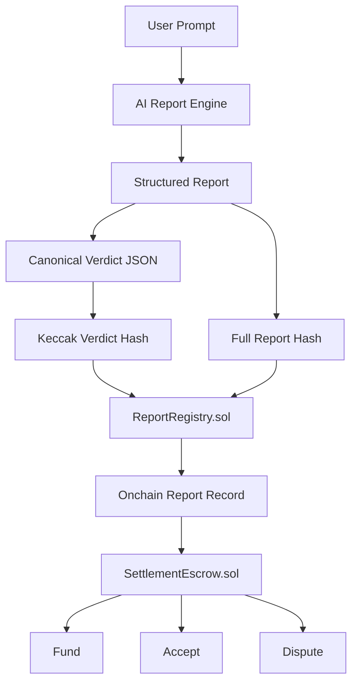

# AgentBond Lite

**AgentBond Lite is an accountable AI research rail on Etherlink.**

AgentBond Lite helps a user ask one governance or token-risk question, get one structured AI report, and then anchor that verdict onchain with a lightweight settlement flow.

Instead of trusting an AI output as an isolated block of text, AgentBond Lite turns the result into:

- a verifiable report commitment
- an Etherlink record
- a transparent accept / dispute trail

This project is built for the Tezos EVM (Etherlink) AI Hackathon.

## The Problem

Web3 teams regularly make decisions using AI-generated summaries, proposal reviews, token analyses, and governance notes.

The problem is that these outputs are usually:

- offchain only
- easy to edit after the fact
- hard to audit
- impossible to settle against

That creates a trust gap. If an AI report influences a launch, treasury action, upgrade, or governance vote, there should be a way to prove what was produced and how that output was handled.

## The Solution

AgentBond Lite generates a structured AI report, reduces it into a deterministic machine-readable verdict, hashes that verdict, and anchors the commitment on Etherlink.

Then the requester can fund a small settlement amount and either:

- accept the report onchain
- dispute the report onchain

This creates a compact but meaningful accountability primitive:

- AI creates the report
- Etherlink stores the report commitment
- settlement records whether that report was accepted or disputed

## Why AI Is Required

The product is not just storing arbitrary user text onchain.

AI is responsible for producing the research output itself:

- reading a prompt
- generating a concise research summary
- extracting key findings
- issuing a recommendation
- assigning a confidence score
- producing a structured verdict payload that can be anchored onchain

Without AI, the core product does not exist.

## Why Etherlink Is Required

AgentBond Lite needs a low-cost, fast, EVM-compatible chain for a clean demoable flow.

Etherlink is the right fit because it gives us:

- low-cost writes for compact report commitments
- fast enough finality for a live demo
- Solidity + Hardhat compatibility
- a familiar EVM development surface

This lets us focus on product clarity instead of custom chain infrastructure.

## Why This Matters for Web3

Web3 increasingly relies on AI for:

- governance analysis
- treasury review
- token-risk assessment
- protocol launch preparation

But AI outputs that influence real onchain decisions should not remain invisible and unauditable.

AgentBond Lite introduces a simple rule:

**if an AI report matters, it should be commit-able, reviewable, and settle-able onchain.**

That makes AI usage in Web3 more legible, more accountable, and easier to reason about.

## What Happens Onchain

AgentBond Lite is explicit about the boundary between offchain and onchain.

### Offchain

- the report is generated
- the full markdown report is assembled
- the canonical verdict JSON is created
- the verdict hash and report hash are computed

### Onchain

- the verdict commitment is registered in `ReportRegistry`
- the requester can fund a small settlement in `SettlementEscrow`
- the requester can accept or dispute the report
- the chain records the accountability trail

We do **not** claim decentralized inference in this Lite version.

## Product Flow

1. User connects wallet.
2. User selects a research mode, with Governance Intelligence as the main path.
3. User submits a prompt.
4. Backend generates a structured report:
   - short summary
   - key findings
   - recommendation: `GO / REVISE / AVOID`
   - confidence score
   - full report
   - canonical verdict JSON
5. User reviews the report in the UI.
6. User anchors the verdict on Etherlink.
7. User optionally funds settlement.
8. User accepts or disputes the report onchain.

## Architecture



## Smart Contracts

### `contracts/ReportRegistry.sol`

Stores the compact commitment to a report.

It records:

- requester
- operator
- mode
- recommendation
- confidence
- verdict hash
- report hash
- content URI
- title

Why it matters:

- proves what verdict was anchored
- emits events for indexing
- creates a durable onchain record for the report

### `contracts/SettlementEscrow.sol`

Adds a lightweight accountability layer.

It supports:

- funding a report settlement
- accepting the report
- disputing the report
- timeout-based refund path
- simple operator stats

Why it matters:

- makes the onchain step economically meaningful
- adds a transparent review trail
- shows whether the report outcome was trusted or challenged

## AI + Onchain Integration

This is the core design.

The backend generates a structured result with fields like:

- `summary`
- `key_findings`
- `recommendation`
- `confidence_bps`

That result is normalized into canonical JSON with stable field ordering. We then compute:

- `verdict_hash = keccak256(canonical_verdict_json)`
- `report_hash = keccak256(full_report_markdown)`

Only the compact commitment is written onchain. The long-form report remains offchain.

This gives us:

- auditability without bloating chain storage
- deterministic payloads
- a clean proof of what was reviewed

## Repo Structure

```text
contracts/
  ReportRegistry.sol
  SettlementEscrow.sol
api/
  ai-report.js
  anchor-payload.js
lib/
  report-engine.js
public/
  index.html
  app.js
  styles.css
scripts/
  deploy.js
  export-abi.js
deployments/
  etherlinkTestnet.json
```

## Network

- Network: `Etherlink Shadownet Testnet`
- Chain ID: `127823`
- RPC: `https://node.shadownet.etherlink.com`
- Explorer: `https://shadownet.explorer.etherlink.com`
- Native token: `XTZ`

## Deployed Contracts

Current Shadownet deployment:

- `ReportRegistry`: `0x93763CA47CEF242F1f64C942e5ebeDC503f7438c`
- `SettlementEscrow`: `0x8DD158865844bBd9c0Fb066F7837F0B0611Feb71`

Deployment metadata:

- [deployments/etherlinkTestnet.json](/Users/denizalagoz/Documents/New%20project/agentbond-lite/deployments/etherlinkTestnet.json)

## Setup

### 1. Install dependencies

```bash
npm install
```

### 2. Configure environment

```bash
cp .env.example .env
```

Set:

- `PRIVATE_KEY` for deployment
- `OPENAI_API_KEY` for live AI generation
- `ETHERLINK_RPC_URL` if you want to override the default RPC

### 3. Compile contracts

```bash
npm run compile
npm run export:abi
```

### 4. Run locally

```bash
npm start
```

Open:

```bash
http://127.0.0.1:8788
```

## Deployment

Deploy to Etherlink Shadownet:

```bash
npm run deploy:etherlink:testnet
npm run export:abi
```

This writes deployment data to:

- [deployments/etherlinkTestnet.json](/Users/denizalagoz/Documents/New%20project/agentbond-lite/deployments/etherlinkTestnet.json)

## Demo Flow

1. Connect wallet.
2. Use the Governance Intelligence mode.
3. Enter a prompt such as:
   - `Review the token design, treasury controls, and upgrade risks. Produce a short report with concrete recommendations.`
4. Generate the report.
5. Show:
   - summary
   - key findings
   - recommendation
   - confidence
6. Click `Anchor verdict`.
7. Show the report record and explorer link.
8. Click `Fund settlement`.
9. Click `Accept report` or `Dispute report`.

## Why This Fits Tezos EVM AI Hackathon

AgentBond Lite maps directly to the hackathon goals:

- **Meaningful AI integration**
  - AI generates the report and structured verdict that drives the product.
- **AI agents interacting with smart contracts**
  - the AI output becomes an onchain report commitment and a settlement object.
- **On-chain AI governance**
  - the main use case is governance, treasury, and upgrade-risk review.
- **Tezos EVM deployment**
  - contracts are deployed on Etherlink Shadownet.
- **Ecosystem impact**
  - this can become a reusable primitive for governance review, treasury operations, and launch readiness checks across the ecosystem.

## Future of AgentBond

Lite is intentionally small and honest.

The full AgentBond roadmap extends this primitive into:

- multi-agent competition
- explicit operator staking
- richer report reputation
- dispute windows and third-party review
- specialized data connectors
- stronger settlement markets for AI work

## Team

- Team member 1: `TBD`
- Team member 2: `TBD`

## Submission Checklist

- [x] Etherlink deployment
- [x] Open-source repo
- [x] README
- [ ] Demo video
- [x] Contract addresses
- [ ] Final hackathon form submission
